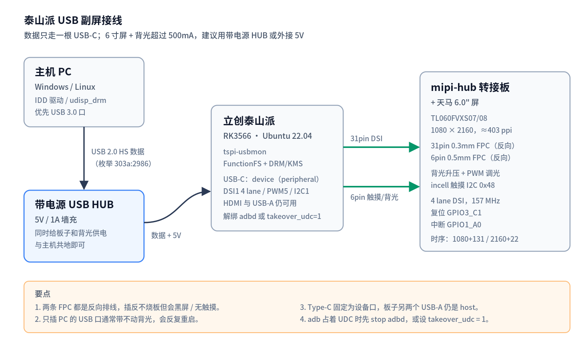

# 02 硬件与接线



> 可编辑的矢量版：[assets/wiring.svg](assets/wiring.svg)

## 1. 屏幕

| 项目 | 参数 |
| --- | --- |
| 型号 | 天马 TL060FVXS07 / TL060FVXS08（6.0 英寸） |
| 分辨率 | 1080 × 2160（竖屏原生，18:9） |
| 接口 | MIPI-DSI，4 lane，视频模式，RGB888 |
| 驱动 IC | Samsung S6D6FT0 |
| 触摸 | incell 电容，I2C（`sec_ts`），最多 10 点（本方案用 5 点） |
| 像素时钟 | 157 MHz，约 59.4 Hz（1080+115+13+3）×（2160+10+10+2）× 59.4 ≈ 157 M |
| 显示区 | ≈ 68 × 136 mm，像素密度 ≈ 403 ppi |
| 背光 | 6pin FPC 供电，PWM 调光（PWM5，40 kHz） |

时序参数（来自 mipi-hub 的泰山派适配，已实机验证）：

```
clock-frequency = 157000000
hactive 1080  hfp 115  hbp 13  hsync 3
vactive 2160  vfp 10   vbp 10  vsync 2
```

## 2. 转接板与排线

使用 [mipi-hub](https://gitee.com/opengisbook/mipi-hub-official) 仓库里
`TL060FVXS07/泰山派/` 的转接板（LCEDA 专业版工程 `PCB文件/ProDoc_TSPI_2026-02-27.epro2`），
它负责：

* 把 31pin 0.3 mm 的屏幕 FPC 接到泰山派的 MIPI-DSI 座；
* 背光升压与 PWM 调光；
* 把 6pin 0.5 mm 的触摸/背光 FPC 接到 I2C1 + PWM5 + 中断脚。

> **两条 FPC 都是反向排线**（金手指朝向与常规相反）。插反不会烧板子，但会黑屏/无触摸，
> 点不亮时先检查这一点。

### 信号对应（与 DTS 一致）

| 信号 | 泰山派资源 | DTS 节点 |
| --- | --- | --- |
| DSI 数据/时钟 | DSI1，4 lane | `&dsi1` + `&video_phy1` |
| 屏幕复位 | GPIO3_C1 | `reset-gpios` / `panel_rst_pin` |
| 背光 PWM | PWM5 | `&pwm5` + `backlight` |
| 触摸 I2C | I2C1，地址 0x48 | `&i2c1` 下 `touchscreen@48` |
| 触摸中断 | GPIO1_A0 | `sec,irq_gpio` / `ts_irq_pin` |

VOP 走 VP1（`dsi1_in_vp1`），HDMI 仍可用（走 VP0），不会互相抢显示通路。

## 3. 供电（最容易踩的坑）

泰山派的 Type-C 既是**数据口**也是**供电口**。作为 USB 副屏时它同时是：

* USB device（枚举成显示器，`MaxPower = 500 mA`）
* 板子 + 屏幕 + 背光的电源

粗略预算：

| 负载 | 功耗 |
| --- | --- |
| RK3566 + LPDDR + eMMC（解码/显示负载） | 1.5 ~ 2.5 W |
| 6 寸屏逻辑 + 背光（约 60% 亮度） | 1.0 ~ 1.5 W |
| 合计 | 2.5 ~ 4 W → **0.5 ~ 0.8 A @5V** |

普通 PC USB2 口只有 500 mA，**带不动**；USB3 口 900 mA 勉强，插拔瞬间/背光全亮时
仍可能掉压重启。SDK 作者也在 README 里明确写了“不要用电脑 USB 口供电，否则会反复重启”。

推荐做法（任选其一）：

1. **带外部供电的 USB HUB**（HUB 给板子供电，数据照常回主机）——最省事；
2. **Y 型线 / 独立 5V**：数据 D+/D− 接主机，5V 从外部电源灌入（共地）。注意不要
   让主机和外部电源同时硬怼 5V；
3. 泰山派排针上的 5V 引脚外接 5V/1A 电源，Type-C 只走数据（需要剪断/改造线缆的
   VBUS，或用带电源注入的 HUB）。

上电顺序无所谓，但**背光瞬间电流最大**，如果开机就重启，先怀疑供电。

## 4. USB 角色

SDK 默认 DTS 是：

```dts
&usbdrd_dwc3 {
    dr_mode = "otg";
    extcon = <&usb2phy0>;
};
```

某些线材/主机组合下 OTG 会停在 host 角色，gadget 就永远不会被枚举。本项目的
DTS 把它固定成：

```dts
&usbdrd_dwc3 {
    dr_mode = "peripheral";
};
```

这样 Type-C 只做设备口（烧录/ADB 也仍然是设备口，不受影响）。板子另外两个
USB-A 仍然是 host，可以接键鼠/U 盘。

如果确实需要这个口偶尔做 host，把上面那行注释掉，插线后检查：

```bash
cat /sys/class/usb_role/*/role        # 应为 device
ls /sys/class/udc                     # 应有 fe800000.usb 之类
```

必要时手动切：

```bash
echo device | sudo tee /sys/class/usb_role/fe800000.usb-role-switch/role
```

## 5. 散热与结构

* 1080×2160 解码 + 双缓冲拷贝会让 A55 长时间跑在 1.5~1.8 GHz，建议给 RK3566
  贴个小散热片；温度可用 `cat /sys/class/thermal/thermal_zone0/temp` 观察。
* 面板背面有背光升压，工作时会发热，3D 打印外壳留出通风孔。
* 屏幕是 6 寸长条，重心偏上，桌面支架建议做成后仰 15°~20°。

## 6. 备件与替代

| 情况 | 建议 |
| --- | --- |
| 没有 mipi-hub 转接板 | 需要自己画 31pin→DSI、6pin→I2C/背光的转接板；背光必须做恒流升压，不能直接 5V 串电阻 |
| 屏是 TL060FVXS07 而非 08 | 两者初始化序列一致，DTS 通用；若亮度/色彩异常，检查背光电流设置 |
| 想用 10.1 寸 1200×1920 屏 | 改 DTS 时序 + `stream` 分辨率即可，帧率按 06 文档重新估算 |
